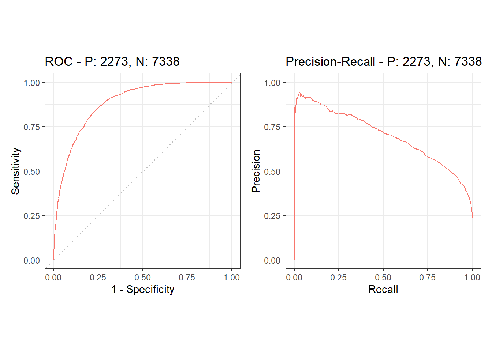

# m6APrediction

An R package for predicting m6A status at candidate sites using a fitted random forest model and sequence and genomic features.

The package provides two prediction functions.

- `prediction_multiple()` scores multiple sites supplied in a data frame.
- `prediction_single()` scores one site supplied as individual feature values.

The package includes the fitted model and a 100-row example feature table. It was developed for BIO215 Practicals 6 and 7 using the course functions and supplied model.

## Installation

The package has been tested with R 4.5.0 and uses `randomForest` and the R `stats` package.

```r
install.packages("remotes")
remotes::install_github("chrisznnyzy-hue/m6APrediction")
```

## Input features

Each site requires the following seven features. For batch prediction, use the exact column names below, with one row per site. Match the feature scales used to train the supplied model.

| Column | Required input |
| --- | --- |
| `gc_content` | Numeric GC fraction between 0 and 1. |
| `RNA_type` | One of `mRNA`, `lincRNA`, `lncRNA`, or `pseudogene`. |
| `RNA_region` | One of `CDS`, `intron`, `3'UTR`, or `5'UTR`. |
| `exon_length` | Exon length already transformed to the log2 scale. |
| `distance_to_junction` | Distance to the junction already transformed to the log2 scale. |
| `evolutionary_conservation` | Numeric conservation score on the training-data scale. |
| `DNA_5mer` | Five uppercase DNA bases from A, T, C, and G, with A in the central position, for example `GGACA`. |

Supply complete feature values. The internal `dna_encoding()` function converts the DNA sequence into five categorical nucleotide-position features used by the model.

## Batch prediction

This example loads the bundled model and data, then predicts the first three sites.

```r
library(m6APrediction)

ml_fit <- readRDS(system.file(
  "extdata", "rf_fit.rds",
  package = "m6APrediction", mustWork = TRUE
))

example_df <- read.csv(system.file(
  "extdata", "m6A_input_example.csv",
  package = "m6APrediction", mustWork = TRUE
))

result <- prediction_multiple(
  ml_fit = ml_fit,
  feature_df = head(example_df, 3),
  positive_threshold = 0.6
)

result[, c("predicted_m6A_prob", "predicted_m6A_status")]
```

Expected output with the bundled model and example data follows.

```text
  predicted_m6A_prob predicted_m6A_status
1              0.876             Positive
2              0.000             Negative
3              0.498             Negative
```

The returned data frame contains the input features and the two prediction columns. `predicted_m6A_prob` is the model's numeric positive-class score. `predicted_m6A_status` is `Positive` when this score is strictly greater than `positive_threshold`; otherwise, it is `Negative`. A score equal to the threshold is `Negative`. The default threshold is 0.5.

## Single-site prediction

This example reads its own model and can be run independently of the batch example.

```r
library(m6APrediction)

ml_fit <- readRDS(system.file(
  "extdata", "rf_fit.rds",
  package = "m6APrediction", mustWork = TRUE
))

prediction_single(
  ml_fit = ml_fit,
  gc_content = 0.6,
  RNA_type = "mRNA",
  RNA_region = "CDS",
  exon_length = 12,
  distance_to_junction = 5,
  evolutionary_conservation = 0.8,
  DNA_5mer = "GGACA",
  positive_threshold = 0.5
)
```

Expected output follows.

```text
  predicted_m6A_prob predicted_m6A_status
              "0.51"           "Positive"
```

The result is a named character vector. Both the score and the status are represented as text because they share one vector.

## Model performance

An earlier BIO215 Practical 3 evaluation trained a random forest on a random 80% training split and evaluated it on the remaining 20%, using seed 123. The held-out test set contained 9,611 sites, including 2,273 positive sites and 7,338 negative sites.



| Metric | Held-out result |
| --- | --- |
| AUROC | 0.8850 |
| AUPRC | 0.6999 |
| Positive fraction in the test set | 0.2365 |

The ROC curve shows sensitivity against the false-positive rate across thresholds. The precision-recall curve shows the trade-off between recovering positive sites and keeping predicted positives accurate in this imbalanced dataset.

**Figure provenance.** These curves and values come from section 3.2 of the saved BIO215 Practical 3 assignment report. They describe the earlier model trained on the 80% split, using the same ten predictors as the packaged model. The supplied `rf_fit.rds` was fitted using the full dataset, so the numbers above are reported as historical validation of the modeling approach. The bundled 100-row table serves as an example for using the prediction interface.

## Package validation

Version 1.0.0 was checked in R 4.5.0 with the following command run from the package project.

```r
devtools::check(args = "--no-manual", cran = FALSE)
```

The check returned **0 errors, 0 warnings, and 0 notes**, including successful execution of both prediction examples. The command skips PDF manual generation.

## Author and license

Author and maintainer: Haotian Shen.

The package uses the MIT license. See [LICENSE.md](LICENSE.md) for the license text and [LICENSE](LICENSE) for the copyright holder information.
